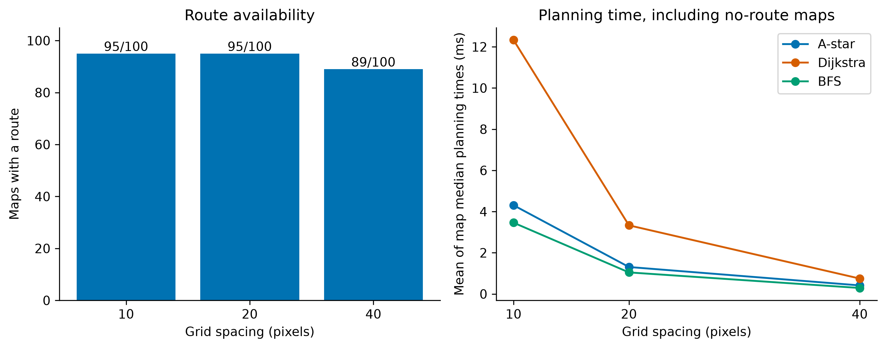
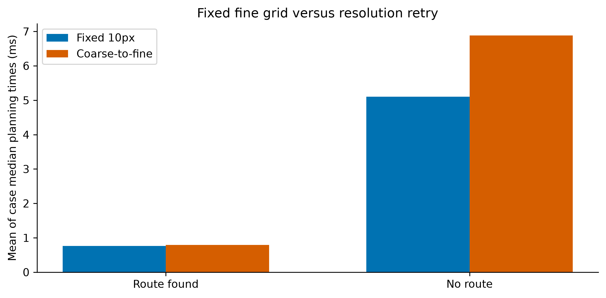
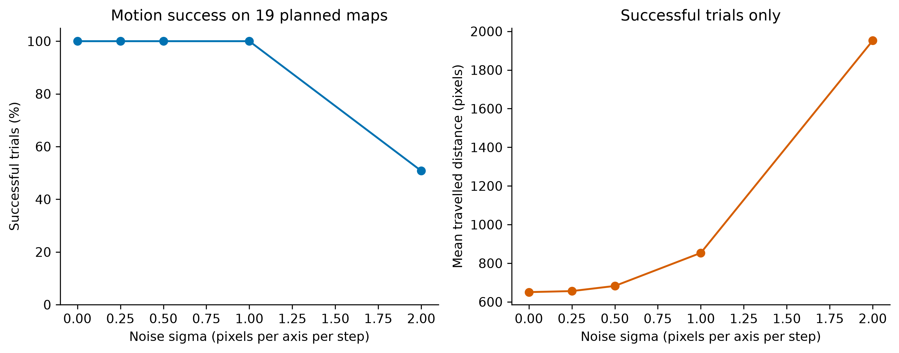
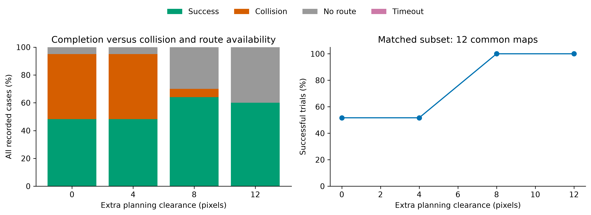
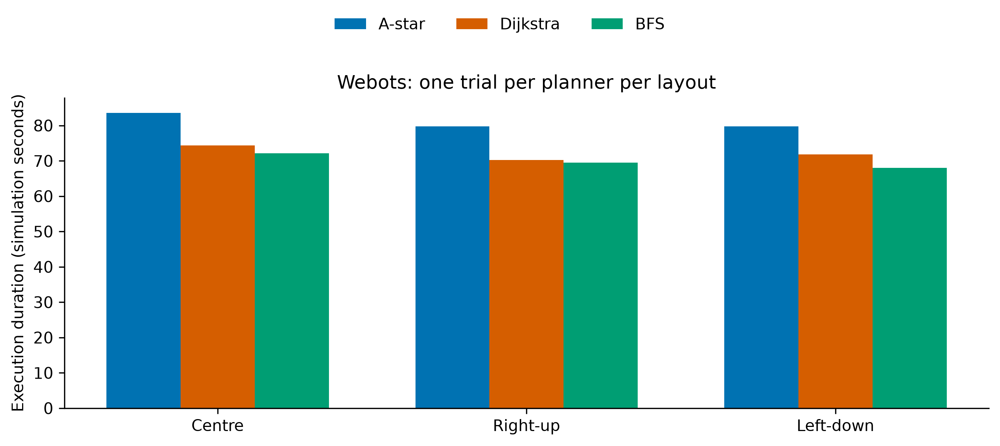
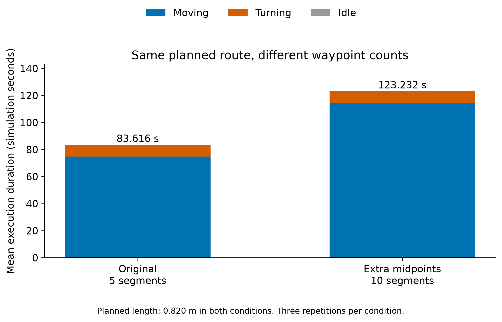

# RoboBench: Effects of Grid Resolution, Planning Clearance, and Route Selection on Simulated Robot Navigation

Author: Shaurya Mahajan

Status: Working draft. A broader literature review, additional validation,
and submission formatting remain to be completed.

## Abstract

This study evaluates how grid resolution, planning clearance, and route
representation affect simulated robot navigation. RoboBench compares
A-star, Dijkstra, and breadth-first search on static rectangular obstacle
maps. Across 100 generated maps, 10- and 20-pixel grids found routes on
95 maps, while a 40-pixel grid found routes on 89. A coarse-to-fine retry
strategy preserved tested fine-grid reachability on 244 passage cases
but did not reduce average planning time. Under simplified Gaussian
displacement noise, additional planning clearance reduced collisions
while making some maps unplannable. An extended Webots study completed
81 trials across nine box placements, with equal planned distances
within each placement but different execution durations. A separate
six-trial control held the planned geometric route fixed: adding
collinear midpoints increased execution time from 83.616 to 123.232
simulation seconds, approximately 47.4%. These observations demonstrate
tradeoffs among planning computation, route availability, and controller
execution in the tested settings.

## 1. Introduction

A planned route is only one component of robot navigation. The grid
representation determines which routes a planner can search. Safety
margins change the available free space. The route-following controller
then determines how the selected route is executed.

RoboBench examines three questions:

1. How does grid spacing affect route availability, distance, and
   planning computation?
2. How does extra planning clearance affect execution under movement
   uncertainty?
3. How do route selection and waypoint representation affect execution
   when planned distances are equal?

The project combines controlled 2D experiments with Webots execution
studies. It evaluates established planning methods rather than proposing
a new graph-search algorithm.

## 2. Background

Dijkstra described a method for finding minimum-length paths in graphs
[1]. Hart, Nilsson, and Raphael developed the heuristic search framework
associated with A-star [2]. LaValle presents discrete search methods,
including breadth-first search, Dijkstra, and A-star, within a common
planning framework [3, Chapter 2].

Breadth-first search provides a shortest-path baseline when graph edges
have equal cost. RoboBench uses four-connected grids with equal edge
costs within each resolution.

Configuration-space planning accounts for robot geometry by excluding
configurations that intersect obstacles [3, Chapter 4]. RoboBench uses
conservative rectangular obstacle inflation, followed by geometric
checks of returned paths.

Michel describes Webots as an environment for modelling, programming,
and simulating mobile robots [4]. Here it provides a wheeled-robot
execution environment distinct from the simplified 2D motion model.

This background establishes the methods used. It does not establish
that the experimental questions represent an unexplored research gap.

## 3. Methods

### 3.1 Planning model

The 2D environment measures 600 by 400 pixels. The physical robot is
represented by a circle with radius 12 pixels. Movement is restricted
to horizontal and vertical grid edges.

A-star uses Manhattan distance. Dijkstra uses the same priority-queue
search with a zero heuristic. Breadth-first search uses a separately
implemented queue-based search.

Planning uses conservative rectangular obstacle inflation. Returned
routes are checked for endpoint correctness, valid steps, map boundaries,
and circular robot clearance. Agreement between planners provides an
additional consistency check rather than proof of correctness.

### 3.2 Grid resolution and resolution retry

One hundred maps, generated using seeds 0 through 99, were evaluated
at grid spacings of 10, 20, and 40 pixels.

Each planner received two warm-up runs and ten recorded runs per map
and spacing. Execution order was shuffled using a fixed seed. Timing
excluded external route validation and file writing.

A separate experiment evaluated 244 passage layouts. Passage widths
were 20, 30, 40, and 60 pixels, with passage centres at every integer
y-coordinate from 160 through 220.

Fixed 10-pixel A-star was compared with a strategy that tried 40,
20, and 10 pixels, stopping at the first successful search. This is
resolution retry rather than a spatially adaptive grid.

Each method received two warm-up runs and ten recorded runs per case.
Retry timing included the complete planning call, input checks, and
all attempted resolutions. External validation and file writing
were excluded.

### 3.3 Movement uncertainty and planning clearance

A simplified holonomic controller moved towards successive waypoints.
Each step commanded up to two pixels of movement and received independent
Gaussian displacement error on each axis. The controller had perfect
position feedback.

The robot used a one-pixel waypoint tolerance and a 10,000-step limit.
Collision checking covered the entire movement segment. Touching an
obstacle counted as collision.

A-star planned on a 20-pixel grid. The noise experiment used 19 reachable
maps from generated seeds 0 through 19. Seed 10 had no planned route
and was excluded. Each noise setting used the same maps and 20 motion
seeds per map.

Noise standard deviations were 0, 0.25, 0.5, 1, and 2 pixels per axis
per movement step.

The clearance experiment included all 20 maps, including unavailable
routes. Extra planning clearances were 0, 4, 8, and 12 pixels, with
movement noise fixed at sigma 2 pixels per axis per step.

The physical radius remained 12 pixels. Planning used this radius plus
the selected clearance, including at map boundaries. Each setting used
20 motion trials per map, with matched trial seeds across settings.

### 3.4 Webots planner comparisons

An E-puck followed routes around a static box measuring 0.2 metres
on each side. Obstacle footprints were calculated from world geometry.

An initial study tested three box placements once per planner,
producing nine trials. A separate extended study tested nine placements,
three planners, and three repetitions per combination, producing
81 trials.

The extended placements used every combination of box-centre
x-coordinates -0.04, 0, and 0.04 metres and y-coordinates -0.03, 0,
and 0.03 metres. The box-centre z-coordinate was 0.1 metres.

Layout/repetition blocks and planner order within each block were
shuffled using seed 42. Before every trial, the robot was returned
to the nominal starting pose, its physics state was reset, and it
settled with stopped wheels for at least 0.5 simulation seconds.

The planning grid spacing was 20 pixels, with a planning radius of
40 pixels and a mapping of 0.001 metres per pixel. These settings
differ from the 2D motion experiments.

The start and goal were approximately (-0.25, 0) and (0.25, 0) metres.
Collinear grid points were removed before execution, retaining
endpoints and turns. Waypoint tolerance was 0.008 metres.

The controller used perfect Supervisor position and orientation
feedback. No motion noise was deliberately added.

When heading error exceeded 0.15 radians, the robot turned in place.
Otherwise, its nominal forward wheel speed was the smaller of
1.5 radians per second and ten times the remaining waypoint distance
in metres. Heading correction used gain 1.5, with wheel speeds limited
to 2 radians per second.

Physical box contact was detected by matching contact-point locations
reported for the robot and named box. Two consecutive front-sensor
readings at or above 120 triggered a separate obstacle-stop outcome.
Planner-comparison trials had a 180-second execution limit.

Execution duration was measured in simulation seconds. Moving, turning,
and idle durations were assigned according to the command active during
each simulation step. Moving commands can include steering corrections.

### 3.5 Controlled waypoint experiment

A separate experiment held the planned geometric polyline fixed:

(-0.25, 0) → (-0.15, 0) → (-0.15, -0.16) →
(0.15, -0.16) → (0.15, 0) → (0.25, 0), in metres.

The original representation had five segments. The second inserted one
collinear midpoint into every segment, producing ten segments while
preserving the same 0.820-metre planned polyline.

Each condition was executed three times. Condition order was shuffled
within each repetition using seed 42. Both conditions used the same
controller, nominal starting pose, reset procedure, and waypoint
tolerance. The execution limit was 300 seconds.

### 3.6 Collinear-waypoint cleanup control

A follow-up experiment tested four conditions: the original route and
the midpoint route, each with and without collinear-point cleanup.
Each condition was executed three times, giving 12 trials.

Cleanup retained corners and endpoints. It converted the ten-segment
midpoint route back into the original five-segment route without
changing the planned geometric polyline or its 0.820-metre length.

The controller, nominal starting pose, reset procedure, and waypoint
tolerance were held fixed. Condition order was shuffled within each
repetition using seed 42. No motion noise was deliberately added.

## 4. Results

### 4.1 Grid resolution

| Grid spacing | Maps with routes | A-star time | Dijkstra time | BFS time |
|---|---:|---:|---:|---:|
| 10 px | 95/100 | 4.308 ms | 12.332 ms | 3.461 ms |
| 20 px | 95/100 | 1.309 ms | 3.333 ms | 1.047 ms |
| 40 px | 89/100 | 0.416 ms | 0.748 ms | 0.291 ms |

Times are means of per-map median planning times, including no-route
cases, from one local experiment run.

The 10- and 20-pixel grids returned identical shortest distances on all
95 mutually reachable maps. Compared with 40 pixels, the 20-pixel grid
recovered six routes and shortened routes on 39 of the 89 maps reachable
at both spacings.

**Figure 1.** Grid resolution results on 100 generated maps. Left:
number of maps with a route; all three planners agreed. Right: mean
of per-map median planning times, including no-route cases. Connecting
lines guide the eye between tested spacings.

### 4.2 Coarse-to-fine retry

Both fixed 10-pixel planning and resolution retry found routes in
153 of 244 passage cases.

For reachable cases, mean case-median times were 0.761 ms for fixed
planning and 0.792 ms for retry. For no-route cases, they were 5.104 ms
and 6.880 ms.

Retry returned longer routes in 41 successful cases. Mean extra distance
across all 153 successful cases was 8.0 pixels, with a maximum of 60 pixels.

**Figure 2.** Mean of per-case median planning times for fixed 10-pixel
A-star and resolution retry. Groups contain 153 cases with routes and
91 without routes. Retry timing includes all attempted resolutions.

### 4.3 Movement uncertainty

At noise sigma values of 0, 0.25, 0.5, and 1 pixel per axis per step,
all 380 trials per setting reached the goal. At sigma 2, 193 of 380
trials succeeded and 187 collided. No timeouts occurred.

Mean travelled distance among successful trials increased from
650.5 pixels at zero noise to 853.4 pixels at sigma 1, approximately
a 31% increase.

At sigma 2, mean successful-trial distance was 1952.3 pixels. This
average excludes failed trials and describes a selected subset.

**Figure 3.** Noise results using 19 planned maps and 20 motion seeds
per map per setting. Left: success rate over 380 trials. Right: mean
travelled distance among successful trials only. The successful subset
changes at sigma 2. Connecting lines guide the eye.

### 4.4 Planning clearance under movement noise

| Extra clearance | Successes / 400 | Collisions | No-route cases |
|---|---:|---:|---:|
| 0 px | 193 | 187 | 20 |
| 4 px | 193 | 187 | 20 |
| 8 px | 256 | 24 | 120 |
| 12 px | 240 | 0 | 160 |

No timeouts occurred. Eight pixels produced the highest overall success
among tested clearances. Twelve pixels produced no observed collisions,
but more cases had no planned route.

On the 12 maps reachable at every clearance, successes increased from
124/240 at zero extra clearance to 240/240 at eight pixels. Mean planned
distance increased from 650.0 to 713.3 pixels.

**Figure 4.** Clearance results at noise sigma 2. Left: outcome proportions
across 400 cases per setting, including unavailable routes. Right:
success rates on the same 12 maps reachable at every clearance,
with 240 trials per setting. Observed 100% success is not a guarantee
of future reliability.

### 4.5 Initial Webots study

All nine initial trials reached the goal without detected box contact.
Mean execution durations across the three placements were 81.08 seconds
for A-star, 72.14 for Dijkstra, and 69.90 for BFS.

**Figure 5.** The initial nine-trial Webots study. Each bar represents
one trial. Planned distances matched within each placement: 0.820 metres
for Centre and 0.740 metres for Right-up and Left-down. This figure
shows the initial study, not the extended 81-trial experiment.

### 4.6 Extended Webots study

All 81 trials reached the goal without detected box contact or other
recorded failure outcomes. Planned distances matched across all planners
and repetitions within each of the nine layouts.

Each value below is the mean of nine layout medians, where each layout
median summarizes three repetitions.

| Planner | Goals | Moving time | Turning time | Total execution |
|---|---:|---:|---:|---:|
| A-star | 27/27 | 72.341 s | 8.693 s | 81.067 s |
| Dijkstra | 27/27 | 63.324 s | 8.779 s | 72.135 s |
| BFS | 27/27 | 63.314 s | 6.549 s | 69.895 s |

Trials included approximately 0.032 seconds of idle time. Independently
summarized components and rounded values may not sum exactly to the
displayed total.

A-star routes contained five segments and four turning episodes.
Dijkstra routes contained four segments and four turning episodes.
BFS routes contained four segments and three turning episodes.

A-star's largest within-layout execution-time range across repetitions
was 0.032 seconds, equal to one simulation step. Dijkstra and BFS had
no measured within-layout execution-time variation.

Relative to Dijkstra, A-star spent approximately 9.017 seconds longer
in moving-command mode, while turning times were nearly equal.
Dijkstra's approximately 2.240-second total difference from BFS was
mostly associated with approximately 2.229 seconds of additional turning.

### 4.7 Controlled waypoint experiment

All six trials reached the goal without detected box contact.

| Condition | Segments | Mean moving time | Mean turning time | Mean total |
|---|---:|---:|---:|---:|
| Original waypoints | 5 | 74.848 s | 8.736 s | 83.616 s |
| Extra midpoints | 10 | 114.624 s | 8.576 s | 123.232 s |

Both representations described the same 0.820-metre planned polyline.
Each trial included approximately 0.032 seconds of idle time.

Adding midpoints increased total execution time by 39.616 seconds,
approximately 47.4%. Moving-command time increased by 39.776 seconds,
while turning-command time decreased by 0.160 seconds.

All three repetitions within each condition had identical durations
at the displayed precision.

**Figure 6.** Mean execution durations across three repetitions per
condition. Both waypoint representations describe the same 0.820-metre
planned polyline. Inserting collinear midpoints increased total duration
from 83.616 to 123.232 simulation seconds. Most of the increase occurred
during moving commands. All six trials reached the goal without detected
box contact. The approximately 0.032-second idle component is too small
to distinguish at this scale.

### 4.8 Collinear-waypoint cleanup

All 12 trials reached the goal without detected box contact.

| Condition | Collision-free goals | Mean execution | Maximum goal error |
|---|---:|---:|---:|
| Original / unchanged | 3/3 | 83.616 s | 0.007963 m |
| Midpoints / unchanged | 3/3 | 123.232 s | 0.007970 m |
| Original / cleanup | 3/3 | 83.616 s | 0.007962 m |
| Midpoints / cleanup | 3/3 | 83.616 s | 0.007963 m |

Cleanup reduced midpoint-route execution time by 39.616 seconds,
approximately 32.1% relative to the unchanged midpoint condition.
The original route and its execution duration were unchanged at the
displayed precision.

This demonstrates the benefit of removing redundant waypoint slowdown
targets for this route and controller. It does not establish a new
planning algorithm or general performance improvement.

The planner-comparison experiments already removed collinear grid
points. This cleanup therefore does not eliminate their differences
in route geometry or explain all between-planner execution differences.

Archived data: data/webots_waypoint_cleanup.csv.
Full report: WAYPOINT_CLEANUP_RESULTS.md.

## 5. Discussion

Coarser grids reduced planning computation but sometimes removed routes
or increased their distance. Trying coarse grids first did not provide
an average speed benefit in the tested passage cases.

Extra clearance improved observed execution success under displacement
noise, but also excluded routes. Minimizing collisions and maximizing
completed tasks across all maps can therefore favour different settings.

The extended Webots study showed consistent execution-time differences
despite equal planned distances within each layout. These differences
describe planner-selected routes executed by this controller, rather
than intrinsic differences in planner computation speed.

The controlled waypoint experiment provides stronger evidence that route
representation affects this controller's execution. Its forward-speed
rule slows the robot as it approaches each waypoint. Inserting midpoints
introduces additional slowdown targets without changing the planned
geometric polyline.

However, this control does not quantify how much of the earlier
between-planner difference was caused by waypoint count. Those routes
also differed in segment lengths and turning requirements.

Executed distance can be shorter than the planned polyline because
waypoints are accepted within a tolerance and steering can begin before
their exact coordinates are reached. This does not demonstrate a better
shortest-path solution.

## 6. Limitations

Generated obstacles align to a 20-pixel grid, which can favour particular
resolutions. Designed passage cases supplement this map set.

The 2D movement model has perfect position feedback and no wheel dynamics.
It is distinct from Webots, so their execution measurements should not
be pooled.

The extended Webots experiment contains nine placements of one box,
rather than 81 independent environments. Repetition checks consistency
under the reset procedure, not robustness to uncertainty.

The waypoint experiment tests one planned route, one controller
configuration, and two waypoint representations. Identical planned
geometry does not guarantee identical executed trajectories.

Webots contact monitoring covers the named box rather than every
possible scene collision. No motion noise was deliberately added,
and pose feedback was obtained directly from the Supervisor.

Trials sharing a map are not independent environment samples.
Timing depends on hardware, system load, and implementation details.
No confidence intervals or statistical significance tests are reported.

Conservative obstacle inflation can exclude physically valid routes.
No-route outcomes can arise from blocked endpoints, clearance margins,
or grid representation, as well as an obstructed environment.

Automated checks and agreement between planners do not eliminate every
possible implementation error. A broader review of navigation benchmarks
and controller-aware planning remains necessary before novelty claims.

## 7. Reproducibility

Repository:
https://github.com/ShauryaMahajan16/RoboBench

Archived 2D summaries and individual Webots trials are stored in data/.
The archived 2D summaries do not contain every individual timing or
motion trial.

The original five figures can be regenerated using:

`python plot_archived_results.py`

The extended Webots report can be regenerated using:

`python analyze_webots_extended.py`

The 81-trial experiment is recorded in data/webots_extended_trials.csv.
The waypoint experiment is recorded in data/webots_waypoint_test.csv.

REPRODUCING.md documents the recorded plotting environment and historical
figure snapshot. WEBOTS_EXTENDED_RESULTS.md and WAYPOINT_RESULTS.md
describe the subsequent experiments.

## 8. Conclusion

In the tested environments, grid resolution and planning clearance
affected route availability, computation, and execution success.

Webots experiments showed that equal planned distance did not imply
equal execution time. A controlled same-polyline experiment further
showed that inserting collinear waypoints increased execution duration
under the tested waypoint-following controller.

These findings support evaluating route representation and controller
behaviour alongside shortest-path distance when comparing navigation
systems.

## References

[1] E. W. Dijkstra, “A note on two problems in connexion with graphs,”
Numerische Mathematik, vol. 1, pp. 269–271, 1959.
https://doi.org/10.1007/BF01386390

[2] P. E. Hart, N. J. Nilsson, and B. Raphael, “A Formal Basis for the
Heuristic Determination of Minimum Cost Paths,” IEEE Transactions on
Systems Science and Cybernetics, vol. 4, no. 2, pp. 100–107, 1968.
https://doi.org/10.1109/TSSC.1968.300136

[3] S. M. LaValle, Planning Algorithms. Cambridge University Press, 2006.
https://msl.cs.uiuc.edu/~lavalle/planning/

[4] O. Michel, “Cyberbotics Ltd. Webots: Professional Mobile Robot
Simulation,” International Journal of Advanced Robotic Systems,
vol. 1, no. 1, 2004.
https://doi.org/10.5772/5618